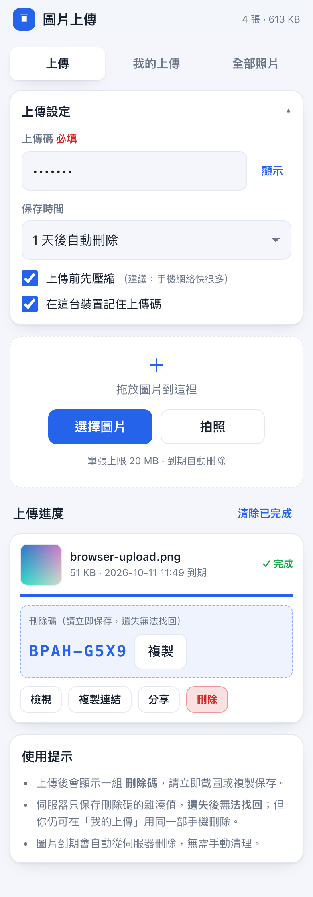
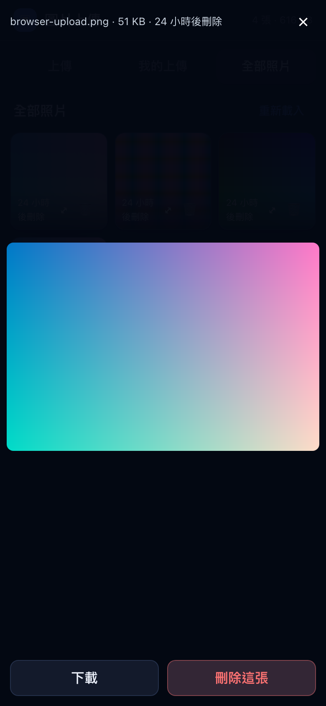

# imgdrop — 極簡手機圖片上傳伺服器

一個給你自己的小工具：**不用登入、不用帳號**，任何人用手機打開網頁、輸入一組「上傳碼」就能上傳照片；每張照片有一組自己的「刪除碼」，到期會自動從伺服器消失。

專為你這種情境設計：**阿里雲 ECS · Ubuntu 24.04 · 2 核 2 GB · 3 Mbps · 照片很快刪除**。

```
┌──────────┐   ① 輸入上傳碼     ┌─────────────────────┐
│  手機 A  │ ───────────────▶  │   imgdrop (ECS)     │
│  手機 B  │   ② 上傳圖片       │                     │
│  手機 C  │ ◀───────────────  │  SQLite + 本機磁碟   │
└──────────┘   ③ 拿到刪除碼     │  到期自動清理        │
              ④ 用刪除碼刪除   └─────────────────────┘
```

---

## 目錄

- [功能](#功能)
- [為什麼是這樣設計](#為什麼是這樣設計)
- [快速開始（本機試跑）](#快速開始本機試跑)
- [部署到阿里雲 ECS](#部署到阿里雲-ecs)
- [日常運維](#日常運維)
- [設定選項](#設定選項)
- [資料庫要選哪個？SQLite vs MySQL vs Supabase](#資料庫要選哪個sqlite-vs-mysql-vs-supabase)
- [安全性](#安全性)
- [HTTP API](#http-api)
- [專案結構](#專案結構)
- [疑難排解](#疑難排解)

---

## 介面

上傳完成後會直接顯示刪除碼，並提供檢視／複製連結／分享／刪除：



點縮圖看大圖，可直接下載或用刪除碼刪除：



---

## 功能

| 功能 | 說明 |
|---|---|
| 🔑 **上傳碼** | 上傳前必須輸入，防止陌生人亂傳。不分大小寫，可選在該裝置記住 |
| 🗑 **刪除碼** | 每張圖片上傳後產生一組 8 碼（如 `BPAH-G5X9`），憑碼刪除 |
| 📱 **同一部手機免碼刪除** | 瀏覽器本機權杖，讓你在「我的上傳」直接刪除自己的照片 |
| ⏳ **自動過期** | 可選 1 小時 ~ 7 天，時間到就從磁碟與資料庫刪除，完全不用管 |
| 🗜 **上傳前壓縮** | 在手機端用 canvas 縮到 2000px 再傳，配合 3 Mbps 頻寬非常關鍵 |
| 🖼 **自動縮圖** | 手機端額外產生 480px 縮圖，相簿一次載入多張也不卡 |
| 🚫 **無需登入** | 沒有帳號、沒有 Cookie 追蹤、沒有第三方服務 |
| 🧩 **零 npm 依賴** | 只用 Node.js 內建模組，伺服器上**不用 `npm install`** |
| 🛡 **自動清理** | 每分鐘檢查過期圖片，並清掉孤兒檔案 |

---

## 為什麼是這樣設計

幾個刻意的選擇，都是為了「2 核 2 GB + 3 Mbps + 照片很快刪除」這個場景：

1. **零 npm 依賴**
   用 `node:http`、`node:sqlite`、`node:crypto` 就夠了。沒有 `node_modules`、沒有供應鏈風險、不用擔心 `npm audit`，部署就是複製檔案 + 啟動。

2. **不用 multipart 上傳，直接送原始二進位**
   前端把圖片本體直接 `POST`，中繼資料放在 HTTP 標頭。這樣伺服器不需要解析 multipart，上傳是**串流寫入磁碟**，20 MB 的圖也只佔幾十 KB 記憶體；而且前端可以用 `XHR` 顯示每張圖的真實進度。

3. **容器格式用 magic bytes 判斷，不信副檔名**
   拒絕 SVG（可藏 XSS）、拒絕 HEIC（瀏覽器看不了）；副檔名一律由伺服器決定，前端給的檔名只當顯示用。

4. **刪除碼只存雜湊**
   `sha256(伺服器密鑰 + 刪除碼)`。就算資料庫外洩也無法反推刪除碼；日誌也從不記錄明文。

5. **圖片與資料庫都在本機**
   你的 3 Mbps 瓶頸是**對外**（別人下載圖片），不是上傳。把圖片放本機磁碟是最快、最便宜、最簡單的做法。（何時該換成對象儲存？看[資料庫那一節](#資料庫要選哪個sqlite-vs-mysql-vs-supabase)。）

---

## 快速開始（本機試跑）

需要 **Node.js 22.13+ 或 24 LTS**（`node:sqlite` 是內建模組）。

```bash
cd imgdrop
cp .env.example .env
# 編輯 .env，至少要改 UPLOAD_CODE
UPLOAD_CODE=mytest123 PORT=3000 node --disable-warning=ExperimentalWarning server.js
```

打開 <http://localhost:3000>，輸入 `mytest123` 就能上傳。

跑測試（會自己開一個獨立伺服器與暫存目錄，不影響你的資料）：

```bash
npm run smoke
```

---

## 部署到阿里雲 ECS

你的機器：`8.138.242.143`（華南3 廣州）· Ubuntu 24.04 · 2 核 2 GiB

### 方法 A：一鍵安裝（推薦）

1. 從你的電腦把整個資料夾上傳到伺服器：

   ```bash
   # 在你自己電腦的 imgdrop 上層目錄執行
   scp -r imgdrop root@8.138.242.143:/root/
   ```

2. SSH 進伺服器執行安裝腳本：

   ```bash
   ssh root@8.138.242.143
   cd /root/imgdrop
   sudo bash deploy/install.sh
   ```

   腳本會自動：裝 Node.js 24 LTS → 建 `imgdrop` 系統使用者 → 複製到 `/opt/imgdrop`
   → 資料放 `/var/lib/imgdrop` → 產生 `.env`（含隨機上傳碼）→ 裝好 systemd 服務並啟動。
   **最後會印出你的上傳碼，請抄下來。**

3. **去阿里雲控制台放行埠**（這步最容易忘記）：

   > ECS 控制台 → 你的實例 → 左側「網絡與安全組」→ 安全組 → 配置規則
   > → 入方向 → 手動添加 → 允許 **TCP 3000**，來源 `0.0.0.0/0`

4. 手機打開 `http://8.138.242.143:3000`，輸入上傳碼即可。

### 方法 B：手動逐步

<details>
<summary>展開看完整指令</summary>

> ⚠️ **如果你用 nvm 裝 Node**：`systemd` 服務**不會**載入 nvm，而且本單元的
> `ProtectHome=true` 會遮蔽 `/root`。所以 nvm 的 Node 對這個服務不可用。
> `deploy/install.sh` 已自動處理（會另外裝一份系統版 Node，不動你的 nvm）；
> 手動安裝的話請務必用 NodeSource 裝到 `/usr/bin/node`，並確認 unit 的 `ExecStart` 指向它。

```bash
# 1) 安裝 Node.js 24 LTS（Ubuntu 內建只有 Node 18，太舊）
curl -fsSL https://deb.nodesource.com/setup_24.x | sudo -E bash -
sudo apt-get install -y nodejs
node -v   # 應該是 v24.x
which node   # 必須是 /usr/bin/node；若是 /root/.nvm/... 就得改

# 2) 建立使用者與目錄
sudo useradd --system --home-dir /opt/imgdrop --shell /usr/sbin/nologin imgdrop
sudo mkdir -p /opt/imgdrop /var/lib/imgdrop
sudo chown imgdrop:imgdrop /var/lib/imgdrop
sudo chmod 750 /var/lib/imgdrop

# 3) 複製程式（假設你已經 scp 到 /root/imgdrop）
sudo cp -a /root/imgdrop/server.js /root/imgdrop/package.json /opt/imgdrop/
sudo cp -a /root/imgdrop/public /root/imgdrop/deploy /opt/imgdrop/
sudo chown -R root:root /opt/imgdrop

# 4) 建立 .env
sudo tee /opt/imgdrop/.env >/dev/null <<'EOF'
UPLOAD_CODE=改成你的上傳碼
SITE_NAME=圖片上傳
PORT=3000
DEFAULT_EXPIRE_HOURS=24
MAX_EXPIRE_HOURS=168
DATA_DIR=/var/lib/imgdrop
PUBLIC_GALLERY=true
TRUST_PROXY=false
EOF
sudo chown root:imgdrop /opt/imgdrop/.env && sudo chmod 640 /opt/imgdrop/.env

# 5) 安裝服務
sudo cp /opt/imgdrop/deploy/imgdrop.service /etc/systemd/system/
sudo systemctl daemon-reload
sudo systemctl enable --now imgdrop
sudo systemctl status imgdrop

# 6) 看日誌
sudo journalctl -u imgdrop -f
```

</details>

### 選用：綁網域 + HTTPS

**HTTPS 不是必需**——`<input capture>` 拍照與選圖在 HTTP 下都能用（程式也已對剪貼簿做了 HTTP fallback）。但有了 HTTPS，體驗會更好（可加到主畫面、剪貼簿穩定）。

> ⚠️ **大陸節點的備案問題**：廣州地域的 ECS，用網域走 **80 / 443 埠必須先完成 ICP 備案**，否則會被攔。沒有備案的話，就繼續用 `IP:3000` 這種高埠，或把實例換到香港地域。
>
> 如果沒有網域，最簡單就是用 `http://8.138.242.143:3000`，這已經完全可用。

有網域的話，最省事的是 **Caddy**（自動申請與續期憑證，兩行設定）：

```bash
sudo apt install -y caddy
sudo cp /opt/imgdrop/deploy/Caddyfile /etc/caddy/Caddyfile
sudo nano /etc/caddy/Caddyfile     # 把 photos.example.com 改成你的網域
sudo systemctl reload caddy
# 然後把 .env 的 TRUST_PROXY 改成 true（否則限流會把所有人當成同一個 IP）
sudo sed -i 's/^TRUST_PROXY=.*/TRUST_PROXY=true/' /opt/imgdrop/.env
sudo systemctl restart imgdrop
```

用 Nginx 的話範例在 `deploy/nginx.conf`。記得兩件事：`client_max_body_size` 要大於 `.env` 的 `MAX_FILE_BYTES`，以及要設 `TRUST_PROXY=true`。

### 選用：只允許自己的 IP 進來

如果只有幾個固定地方要用，可以在安全組把來源限制成你的 IP；或在伺服器上裝 ufw：

```bash
sudo ufw allow 22/tcp
sudo ufw allow 3000/tcp        # 或只 allow from 你的IP to any port 3000
sudo ufw enable
```

---

## 日常運維

```bash
# 服務狀態 / 開關 / 重啟
sudo systemctl status imgdrop
sudo systemctl restart imgdrop
sudo systemctl stop imgdrop

# 即時日誌（上傳與刪除都會記錄，但不含任何明文密碼）
sudo journalctl -u imgdrop -f

# 看用量（需要 .env 裡的 ADMIN_KEY）
curl -H "X-Admin-Key: $(sudo grep '^ADMIN_KEY=' /opt/imgdrop/.env | cut -d= -f2)" \
     http://127.0.0.1:3000/api/stats

# 立刻手動清理過期圖片與孤兒檔案
curl -X POST -H "X-Admin-Key: ..." http://127.0.0.1:3000/api/admin/cleanup

# 看資料庫裡有什麼
sudo sqlite3 /var/lib/imgdrop/imgdrop.db \
  "SELECT id, mime, size/1024||'KB', datetime(created_at/1000,'unixepoch','localtime'),
          datetime(expires_at/1000,'unixepoch','localtime') FROM photos ORDER BY created_at DESC LIMIT 20;"

# 看目前佔用
sudo du -sh /var/lib/imgdrop/*
```

### 備份

圖片都是**暫時性**的，所以通常不需要備份。真的要備份 metadata：

```bash
sudo tar czf ~/imgdrop-backup-$(date +%F).tgz -C /var/lib/imgdrop .
```

> ⚠️ `/var/lib/imgdrop/secret.key` 是伺服器自動產生的密鑰，**不要刪**。刪掉之後所有已發出的刪除碼都會失效。

### 改上傳碼

```bash
sudo nano /opt/imgdrop/.env      # 改 UPLOAD_CODE
sudo systemctl restart imgdrop
```

### 更新程式

```bash
# 重新 scp 新的程式碼上來後
sudo bash deploy/install.sh      # 會保留 .env 與圖片
```

---

## 設定選項

所有設定都在 `/opt/imgdrop/.env`，改完 `sudo systemctl restart imgdrop`。

| 變數 | 預設 | 說明 |
|---|---|---|
| `UPLOAD_CODE` | **（必填）** | 上傳碼，不分大小寫 |
| `SITE_NAME` | `imgdrop 圖片上傳` | 頁面標題 |
| `PORT` | `3000` | 監聽埠（安全組要放行同一個） |
| `DATA_DIR` | `./data` | 資料目錄（安裝腳本設為 `/var/lib/imgdrop`） |
| `DEFAULT_EXPIRE_HOURS` | `24` | 預設保存時數 |
| `MAX_EXPIRE_HOURS` | `168` | 最長保存時數（7 天） |
| `ALLOWED_EXPIRE_HOURS` | `1,6,24,72,168` | 前端下拉選單的選項 |
| `MAX_FILE_BYTES` | `20971520`（20 MB） | 單張上限 |
| `MAX_TOTAL_BYTES` | `2147483648`（2 GB） | 總容量配額，滿了拒絕新上傳 |
| `MAX_PHOTOS` | `20000` | 圖片張數上限 |
| `MAX_THUMB_BYTES` | `1048576` | 縮圖大小上限 |
| `PUBLIC_GALLERY` | `true` | 是否開放「全部照片」分頁 |
| `ADMIN_KEY` | 空 | 管理金鑰；空 = 關閉管理 API |
| `MAX_UPLOADS_PER_HOUR` | `120` | 每個 IP 每小時上傳上限 |
| `MAX_UPLOADS_GLOBAL_PER_HOUR` | `2000` | 全站每小時上傳上限 |
| `MAX_DELETES_PER_HOUR` | `120` | 每個 IP 每小時刪除上限 |
| `TRUST_PROXY` | `false` | 有 Nginx/Caddy 時設 `true` |
| `HASH_SECRET` | 自動產生 | 覆寫 `secret.key` |
| `LOG_REQUESTS` | `false` | 記錄每個請求（除錯用） |

> 🔓 **`PUBLIC_GALLERY=true` 的隱私提醒**：任何知道網址的人都能看到「全部照片」分頁。
> 如果你只想讓上傳者自己看，改成 `false`（這樣就只有「我的上傳」分頁，靠瀏覽器本機權杖辨識）。
> 圖片網址本身是 12 碼隨機（32¹² ≈ 1.2×10¹⁸ 種），無法猜測。

---

## 資料庫要選哪個？SQLite vs MySQL vs Supabase

**直接回答：你這個情境，用 Node 內建的 SQLite 最好，不需要 MySQL，也不需要 Supabase。**

先看實際資料量。每張圖片在資料庫裡只有**一列**，大約 300 bytes：

| 圖片數量 | 資料庫大小 | 圖片檔案大小 |
|---|---|---|
| 100 張 | ~30 KB | ~200 MB |
| 1,000 張 | ~300 KB | ~2 GB |
| 10,000 張 | ~3 MB | ~20 GB（但你會過期刪掉） |

圖片本體無論如何都要存在某個地方。**資料庫在這裡只是一個索引**，不是主角。

### 為什麼 SQLite 在這裡勝出

| 考量 | SQLite（本機） | MySQL（本機） | Supabase（雲端） |
|---|---|---|---|
| 安裝 | **Node 內建，零安裝** | 裝 server、設帳密、調參數 | 註冊、開專案、拿金鑰 |
| 讀寫延遲 | **微秒級（同機記憶體/檔案）** | 毫秒級（本機 socket） | **幾十~幾百毫秒（跨國 HTTPS）** |
| 2 GB 機器的負擔 | **幾乎為 0** | mysqld 常駐吃 200~400 MB | 0（但你仍然要跑 Node 服務） |
| 併發 | 單程序 + WAL 完全夠用 | 過度設計 | 很強（但你不需要） |
| 成本 | **0** | 0（但耗資源） | 免費層有限制，會休眠 |
| 備份 | **複製一個目錄就好** | `mysqldump` + 還原流程 | 依賴對方後台 |
| 故障點 | 一個 | 兩個 | **三個（還要加上網路與對方服務）** |
| 離線可運作 | ✅ | ✅ | ❌ |

關鍵三點：

1. **Supabase 在海外。** 你的 ECS 在廣州，每寫一列都要跨國來回。手機上傳完等資料庫回應，體驗反而變差；而且 Supabase 一掛，你的整個服務就跟著掛。

2. **Supabase 只解決了一半問題。** 它強的是 Postgres 資料庫與 Storage。但你的圖片還是得有地方放。用 Supabase Storage 的話，你根本就**不需要這台 ECS** 了——那會是另一種架構（伺服器無關，但依賴境外服務、要處理 CORS、上傳速度受跨境頻寬影響）。兩者混用＝又多一個依賴，沒有換到好處。

3. **MySQL 對這個規模是浪費。** 這是一張表、四個索引、每天幾百次寫入。SQLite 的 WAL 模式在同一時間只有一個寫入者，但你的併發量大約是「你自己和幾個朋友」——離 SQLite 的極限還差好幾個數量級。

### 什麼時候該換？

| 情況 | 建議 |
|---|---|
| 圖片要長久保存、要 CDN、多地區 | 圖片改放**阿里雲 OSS**（同區內網免流量費），資料庫仍可留 SQLite |
| 要多台 ECS 同時服務 | SQLite 是單機檔案 → 換 Supabase / RDS PostgreSQL |
| 要做全文檢索、複雜報表 | 換 PostgreSQL（Supabase 或阿里雲 RDS） |
| 完全不想管伺服器 | 全部搬到 Supabase Storage，ECS 直接退掉 |

### 之後真的要換，成本高嗎？

不高。所有 SQL 都集中寫在 `server.js` 裡面的 `q` 物件（9 條 prepared statement），把 `node:sqlite` 換成 `pg` 大約就是改那 9 條 + 連線設定，**一個小時內的事**。所以現在先用 SQLite，等真的需要再換，不會被綁死。

---

## 安全性

### 已經做了

- 上傳碼比對用**常數時間比較**，避免時間側通道
- 刪除碼與裝置權杖**只存雜湊**（`sha256(secret + 值)`），資料庫外洩也無法反推
- `secret.key` 權限 `600`，由伺服器首次啟動自動產生
- 檔案類型用 **magic bytes** 判斷，**拒絕 SVG**（可嵌入腳本）
- 圖片回應帶 `Content-Security-Policy: default-src 'none'; sandbox` 與 `X-Content-Type-Options: nosniff`
- 靜態頁面帶 CSP，不允許 inline script
- 路徑穿越防護（`/../server.js` 之類會被擋）
- 分頁帶 `X-Robots-Tag: noindex`，不會被搜尋引擎收錄
- 每個 IP 與全站的**上傳/刪除/列表速率限制**
- 總容量與張數配額，防止塞爆磁碟
- systemd 加固：`ProtectSystem=strict`、`NoNewPrivileges`、`PrivateTmp`、獨立低權限使用者
- 刪除碼可容錯輸入（`bpah-g5x9`、`BPAHG5X9` 都通）

### 沒有做（請自行評估）

- **沒有加密**：`http://` 是明文傳輸。同一 WiFi 下有能力的人可以看見上傳碼。要避免就上 HTTPS。
- **上傳碼是共用的**：所有拿到碼的人都能上傳，也能看到「全部照片」。屬於「共享秘密」模型，不是帳號系統。
- **沒有病毒掃描**：只驗證是不是圖片，不驗證圖片內容。
- 圖片被判定為圖片後就以該型別回傳，瀏覽器不會執行它（因為不是 SVG/HTML）。

### 建議

1. 上傳碼用**混合大小寫＋數字**，例如 `Kf7mQ2xR9t`，不要用 `1234`。
2. 如果只有自己用，把 `PUBLIC_GALLERY` 設成 `false`。
3. 安全組只放行你需要的埠，SSH 埠限制來源 IP。
4. 想更安全就上 HTTPS（Caddy 兩行設定）。

---

## HTTP API

| 方法 | 路徑 | 說明 |
|---|---|---|
| `GET` | `/` | 手機上傳頁面 |
| `GET` | `/api/config` | 前端需要的設定（公開） |
| `GET` | `/api/health` | 健康檢查（張數、用量） |
| `POST` | `/api/upload` | 上傳圖片（原始二進位 body） |
| `POST` | `/api/photo/:id/thumb` | 補上縮圖（需裝置權杖） |
| `GET` | `/api/photo/:id` | 單張圖片資訊 |
| `DELETE` | `/api/photo/:id` | 刪除（需刪除碼或裝置權杖） |
| `GET` | `/api/photos?scope=mine\|all&limit=&before=` | 列出圖片 |
| `GET` | `/i/:id` | 原圖（`inline`） |
| `GET` | `/t/:id` | 縮圖（沒有縮圖時回原圖） |
| `GET` | `/d/:id` | 下載（`attachment`） |
| `GET` | `/api/stats` | 用量統計（需管理金鑰） |
| `POST` | `/api/admin/cleanup` | 手動清理（需管理金鑰） |

### 用 `curl` 上傳

```bash
# X-File-Name 要 URL-encode（下面的 %E7%9B%B8%E7%89%87 是「相片」），不填也可以
curl -X POST http://8.138.242.143:3000/api/upload \
  -H "X-Upload-Code: 你的上傳碼" \
  -H "X-Device-Token: mydevice0001" \
  -H "X-Expire-Hours: 6" \
  -H "X-File-Name: %E7%9B%B8%E7%89%87.jpg" \
  -H "Content-Type: image/jpeg" \
  --data-binary @photo.jpg

# 回應
# {"ok":true,"id":"6k6v6cv43tm8","deleteCode":"F3TM8RHZ",
#  "url":"/i/6k6v6cv43tm8","thumbUrl":"/t/6k6v6cv43tm8",
#  "expiresAt":1786000000000, ...}
```

### 用 `curl` 刪除

```bash
curl -X DELETE http://8.138.242.143:3000/api/photo/6k6v6cv43tm8 \
  -H "X-Delete-Code: F3TM8RHZ"
```

---

## 專案結構

```
imgdrop/
├── server.js                  # 整個後端（HTTP + 路由 + SQLite + 清理）
├── package.json               # 沒有 dependencies，只有 scripts
├── .env.example               # 設定範本
├── public/
│   ├── index.html             # 手機優先介面
│   ├── app.js                 # 壓縮、上傳、相簿、刪除
│   ├── style.css              # 深色/淺色自動切換
│   ├── manifest.webmanifest   # 可加到手機主畫面
│   └── icon.svg
├── test/
│   └── smoke.js               # 32 項端到端測試
└── deploy/
    ├── install.sh             # 阿里雲一鍵安裝
    ├── imgdrop.service        # systemd 單元（已加固）
    ├── Caddyfile              # 自動 HTTPS 範例
    └── nginx.conf             # Nginx 反向代理範例

/var/lib/imgdrop/              # 執行時產生的資料
├── imgdrop.db                 # SQLite（+ WAL 檔）
├── secret.key                 # 雜湊密鑰（600，勿刪）
├── files/                     # 原圖 <id>.<ext>
├── thumbs/                    # 縮圖 <id>.jpg
└── tmp/                       # 上傳中的暫存片段
```

---

## 疑難排解

**手機連不上**
→ 九成是安全組沒放行。ECS 控制台 → 安全組 → 入方向 → 加 TCP 3000。
→ 在本機確認服務有在聽：`sudo ss -ltnp | grep 3000`

**「上傳碼不正確」但明明打對了**
→ 上傳碼不分大小寫，但**前後空白會被忽略、中間不行**。確認 `.env` 的值沒有引號或多餘空白，改完要重啟。

**上傳到一半失敗**
→ 預設單張上限 20 MB。調大 `MAX_FILE_BYTES`，同時 Nginx 的 `client_max_body_size` 與 Caddy 的 `request_max_size` 也要跟著調大。

**圖片上傳成功但很慢 / 相簿要等很久**
→ 你的對外頻寬是 3 Mbps ≈ 375 KB/s，這是**下載**圖片的速度上限。
→ 確保「上傳前先壓縮」有勾選（預設開），這樣原圖會縮到 2000px、縮圖只有 480px，相簿載入會快很多。

**HEIC 上傳被拒絕**
→ iPhone 的 HEIC 格式瀏覽器無法顯示。選圖時勾選「上傳前先壓縮」讓瀏覽器轉成 JPEG 即可（iOS 通常在選圖時就自動轉了）。

**服務起不來**
```bash
sudo journalctl -u imgdrop -n 80 --no-pager
node -v          # 必須 22.13+ 或 24.x
```
最常見原因是 Node 版本太舊（Ubuntu 內建 18 沒有 `node:sqlite`）。

**「伺服器儲存空間已滿」**
→ 到了 `MAX_TOTAL_BYTES` 配額。等過期自動清理，或手動跑 `/api/admin/cleanup`，或把 `MAX_TOTAL_BYTES` 調大。順便看一下 `df -h`。

**所有人都被限流，說「操作太頻繁」**
→ 如果你用了 Nginx/Caddy 但沒設 `TRUST_PROXY=true`，所有人看起來都是 `127.0.0.1` 同一個 IP。改 `.env` 後重啟。

**想重置一切（刪掉所有圖片）**
```bash
sudo systemctl stop imgdrop
sudo rm -rf /var/lib/imgdrop/files/* /var/lib/imgdrop/thumbs/* /var/lib/imgdrop/imgdrop.db*
sudo systemctl start imgdrop
```

---

## 之後可以加的功能

如果你用完覺得需要，這些都很好加（改動都不大）：

- 相簿密碼（讓「全部照片」需要另一組碼才能看）
- 上傳後自動產生 QR Code 方便分享
- 支援多檔上傳時的整體進度與取消
- 圖片浮水印 / EXIF 移除（伺服器端需要額外依賴）
- 改用阿里雲 OSS 存圖片（同區內網流量免費，且不怕磁碟滿）
- 自動把所有上傳同步一份到你的 NAS

---

## 授權

MIT — 自己的伺服器，自己作主。
